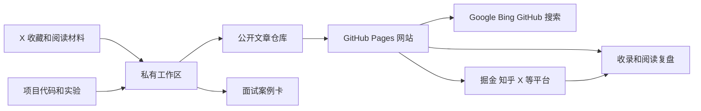
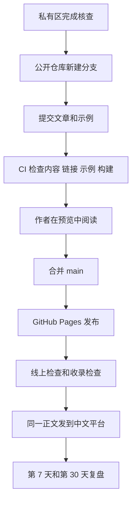

# 架构设计

版本：2026-11-01

## 1. 目标与边界

这个项目要同时完成三件事：

1. 把 AI Agent 工程相关的阅读、实验和项目经验写成可靠的中文文章。
2. 让目标读者能通过 GitHub、搜索引擎和中文平台找到这些文章。
3. 让每篇文章都能转成一个面试中可讲、可追问的技术案例。

不追求热点覆盖量。新技术讨论可以写，但必须说明它解决什么问题、代价是什么、适用边界在哪里。

## 2. 总体结构



采用“两仓库”结构：

| 位置 | 是否公开 | 放什么 | 不放什么 |
| --- | --- | --- | --- |
| `engineering-notes` | 公开 | 网站代码、成品文章、示例代码、图片、更正记录 | X 收藏原文、面试答案、私人笔记、平台后台数据 |
| `engineering-notes-workbench` | 私有或仅本地 | 收藏选题、资料摘录、草稿、核查记录、面试卡、发布数据 | 准备公开的网站构建产物 |

两边通过文章 `slug` 关联。私有区可以引用公开文章；公开仓库不依赖私有区才能构建。

## 3. 公开仓库结构

```text
engineering-notes/            # GitHub 仓库名 wanghao-SunSky.github.io
  README.md
  AGENTS.md
  package.json
  astro.config.mjs
  src/
    content.config.ts         # 文章 front matter 校验
    data/site.ts              # 站点信息、作者、主题
    lib/posts.ts
    layouts/Base.astro        # SEO 元信息、结构化数据、统计脚本
    components/PostList.astro
    pages/
      index.astro
      posts/[slug].astro
      topics/index.astro
      topics/[topic].astro
      about.astro
      404.astro
      rss.xml.ts
    styles/global.css
  content/
    posts/<slug>/index.md     # 文章正文，图片放同一目录
  public/
    robots.txt
    favicon.svg
    og/<slug>.png             # 1200×630 分享图
  scripts/
    check-content.mjs         # 构建前检查 slug、标题、描述、封面、本机路径
    og.mjs                    # 用本机 Chrome 生成分享图
  docs/                       # 架构、流程、规范、平台调研、进度记录
  templates/
  .agents/skills/tech-article-writer/SKILL.md
  .github/workflows/deploy.yml  # PR 只构建，main 构建并部署 Pages
```

计划中、还没实现：`examples/<slug>/`（文章配套可运行代码）、`content/series/`、`scripts/check-links.mjs`（外链检查）、IndexNow 和百度主动推送、`.github/ISSUE_TEMPLATE/`（更正和选题请求）。

文章正文放在 `content/posts/<slug>/index.md`，图片和文章放在一起。可运行代码放在 `examples/<slug>/`，文章引用其固定版本链接。这样读者能直接查看代码，代码检查也不会混进正文构建。

## 4. 私有工作区结构

```text
engineering-notes-workbench/
  inbox/
    x-bookmarks.csv
  topics/
    backlog.md
    scoring.md
  briefs/
    <slug>.md
  drafts/
    <slug>.md
  verification/
    <slug>.md
  interview/
    cards/<slug>.md
    question-bank.md
  distribution/
    <slug>.yml
  metrics/
    YYYY-MM.md
```

`x-bookmarks.csv` 只保存链接、作者、收藏日期、主题、个人备注和处理状态。需要摘录原文时只保留核查所需的短引用，不把整段帖子或长文批量复制进来。

## 5. 网站方案

首选 Astro 静态站，部署到 GitHub Pages。

原因：

- 文章是 Markdown 文件，适合 Git 管理和代码评审。
- 构建结果是静态 HTML，搜索引擎容易抓取，也不需要服务器。
- Astro 的内容集合可以用 schema 检查 front matter。
- GitHub Pages 可以通过 GitHub Actions 自动部署。

页面排版、首页和文章页结构、分享图规则见 [site-design.md](site-design.md)。

参考：[Astro 部署到 GitHub Pages](https://docs.astro.build/en/guides/deploy/github/)、[GitHub Pages 说明](https://docs.github.com/en/pages/getting-started-with-github-pages/what-is-github-pages)。

备选方案：

| 方案 | 适合 | 不作为首选的原因 |
| --- | --- | --- |
| 只用 GitHub README 和 Markdown | 很快开始 | 站点导航、主题页、RSS、分享卡片和收录控制较弱 |
| VitePress | 文档和教程 | 更偏文档站，文章列表、系列和长期博客展示需要更多定制 |
| ChatGPT Site | 已有快速发布流程 | 可以作为临时展示，但长期内容资产更适合由仓库直接构建和迁移 |
| 自建 CMS | 多人编辑 | 早期维护成本过高 |

### 域名与仓库

已决定：先用 GitHub 免费子域名，正式地址为 `https://wanghao-sunsky.github.io/`。

| 选择 | 地址 | 结论 |
| --- | --- | --- |
| GitHub 用户站点 | `https://wanghao-sunsky.github.io/` | 采用。地址最短，`site` 直接填这个地址，不需要 `base` |
| 复用 `agent-engineering-notes` 作项目站点 | `https://wanghao-sunsky.github.io/agent-engineering-notes/` | 不采用。地址长，所有链接都要带 `base`；该仓库现在是英文笔记，定位不同 |
| 自有域名 | `notes.<domain>` | 以后再买。旧 `github.io` 地址能否自动跳到新域名本轮没查到官方说明，迁移前先在测试仓库验证；文章的 canonical 一开始就统一由 `site` 配置生成，换域名时只改一处 |

因此公开仓库在 GitHub 上命名为 `wanghao-SunSky.github.io`（每个账号只能有一个用户站点）。本地目录仍叫 `engineering-notes`。已有的 `agent-engineering-notes` 保持不动，其中观点可以改写成中文文章后放进新站，再在旧仓库 README 顶部加一行新站链接。

依据：[Astro 部署到 GitHub Pages](https://docs.astro.build/en/guides/deploy/github/)（用户站点不设 `base`，Pages 的 Source 选 GitHub Actions）；[GitHub Pages 限制](https://docs.github.com/en/pages/getting-started-with-github-pages/github-pages-limits)（站点不超过 1 GB，每月软带宽 100 GB，用 Actions 发布时不受每小时 10 次构建的软限制）；[自定义域名说明](https://docs.github.com/en/pages/configuring-a-custom-domain-for-your-github-pages-site/about-custom-domains-and-github-pages)。

### 访问统计

先接 Cloudflare Web Analytics：免费，官方写明所有套餐可用；官方产品页写明不使用 Cookie、localStorage 等客户端状态，也不做指纹识别（[Cloudflare Web Analytics](https://www.cloudflare.com/web-analytics/)）；站点不经过 Cloudflare 代理也能用，只需在页面底部插入一段 JS。它只回答“哪些页面有人看、从哪来”，满足第一阶段需要。

| 方案 | 结论 | 原因 |
| --- | --- | --- |
| Cloudflare Web Analytics | 采用 | 免费、隐私友好、接 GitHub Pages 只要一段脚本 |
| GA4 | 暂不用 | 功能多，但 GA4 标签用第一方 Cookie 区分用户和会话（[GA4 Cookie 说明](https://support.google.com/analytics/answer/11397207)）；当前不需要转化漏斗 |
| 百度统计 | 暂不用 | 需要百度账号；国内来源是否更准、是否要实名均未核实；百度收录起来后再评估 |
| GoatCounter、Umami | 未核实 | 本轮官网 SSL 握手失败，免费额度和可用性未确认 |

统计脚本的 token 放在构建环境变量里，未配置时不输出脚本，避免本地预览产生数据。脚本被广告拦截插件挡住时会少算，数字只看趋势。

### 作者与署名

作者公开 GitHub 账号 `wanghao-SunSky`，显示名默认 `SunSky`。是否同时写真名由作者决定，确定后写进 `src/data/site.ts` 的 `AUTHOR`，所有文章、关于页和结构化数据（`Person` 的 `name` 与 `sameAs`）统一使用。不公开手机号、邮箱和公司内部信息。

## 6. 内容模型

### 文章类型

| 类型 | 解决的问题 | 最低证据 |
| --- | --- | --- |
| `explainer` | 一个概念或机制怎么工作 | 原始论文、官方文档或源码 |
| `experiment` | 某个方案在给定条件下表现如何 | 可复现实验设置、代码、结果和局限 |
| `case-study` | 一个真实项目为什么这样设计 | 代码链接、提交记录、测试或线上证据，敏感信息脱敏 |
| `perspective` | 如何判断一个新技术 | 至少两类可靠资料，观点与事实分开 |
| `reading-note` | 对一篇重要材料的结构化解读 | 原文链接和个人新增分析，不能主要是摘要 |

### Front matter

```yaml
title: "Agent 的长期记忆，为什么不只是一个向量数据库"
description: "从写入、检索、更新和遗忘四个环节，解释 Agent 长期记忆需要哪些额外设计。"
slug: agent-memory-is-not-vector-db
type: explainer
status: published
publishedAt: 2026-11-15
updatedAt: 2026-11-15
topics: [agent-memory]
tags: [RAG, vector-db, memory]
series: agent-engineering
level: intermediate
evidence: [source, code, test]
aiAssisted: true
canonical: https://wanghao-sunsky.github.io/posts/agent-memory-is-not-vector-db/
sources:
  - title: "Source title"
    url: "https://example.com"
    accessedAt: 2026-11-15
code:
  repo: https://github.com/wanghao-SunSky/wanghao-SunSky.github.io
  path: examples/agent-memory-is-not-vector-db
corrections: []
```

内容 schema 至少检查：标题、描述、`slug` 唯一、日期格式、类型、主题、来源链接和发布状态。`draft` 和 `review` 状态不生成公开页面。

### 主题体系

先用 5 个稳定主题：

- `agent-architecture`：Agent 循环、规划、执行与状态
- `tool-calling`：工具调用、权限、预算和失败处理
- `agent-memory`：长期记忆、检索、更新和遗忘
- `agent-evaluation`：评测设计、回归测试和可靠性
- `agent-security`：提示注入、数据边界和安全控制

标签可以变化，主题地址要保持稳定。每个主题页需要一段原创导读和推荐阅读顺序，不能只有文章列表。

## 7. 发布链路



CI 失败时不发布。线上地址检查通过后，再发布到中文平台。

## 8. 自动检查

| 检查 | 失败条件 |
| --- | --- |
| 内容 schema | 缺少必要字段、`slug` 重复、日期或主题无效 |
| 链接 | 内部链接失效；外部链接失效时生成警告，由作者判断 |
| 示例代码 | 文章声明可运行的示例无法安装或测试失败 |
| 构建 | Astro 构建失败或生成空页面 |
| SEO 基础 | 缺少标题、描述、规范地址，标题或描述重复 |
| 隐私 | 发现密钥、令牌、个人联系方式、公司内部域名或私有路径 |

自动检查只证明格式和构建可用，不能证明技术内容正确。

## 9. 面试复用

每篇公开文章对应一张私有面试卡：

- 一句话问题
- 当时的约束
- 备选方案和取舍
- 我的实际工作
- 证据链接
- 当前局限
- 面试官可能追问的 5 个问题

公开文章展示可公开的思考和证据；面试卡保存更口语化的讲述和个人判断。项目经历中的保密信息只写抽象结论，不写内部名称、数据或截图。

## 10. 关键决策

| 编号 | 决策 | 原因 |
| --- | --- | --- |
| ADR-001 | 自己的网站为原始发布地址 | 统一保存版本、更正和 SEO 资产 |
| ADR-002 | 公开仓库和私有工作区分开 | 避免泄露收藏原文、面试答案和后台数据 |
| ADR-003 | Markdown + Astro + GitHub Pages | 简单、可迁移、易审阅、搜索引擎友好 |
| ADR-004 | 平台发和网站相同的正文，只换标题和文末链接 | 每篇单独改写成本高；接受平台页可能排名更高，用网站先发、“首发于”链接减少影响 |
| ADR-005 | 证据等级写入 front matter | 让读者和自己都能区分资料解读、实验和生产经验 |
| ADR-006 | 新建用户站点仓库，不复用 `agent-engineering-notes` | 根路径地址最短，SEO 和链接最简单；旧仓库定位是英文笔记 |
| ADR-007 | 统计先用 Cloudflare Web Analytics | 免费、官方写明不用 Cookie、接入只需一段脚本 |
| ADR-008 | 写作由 Agent 辅助，作者负责观点和核查 | 见 [writing-agent.md](writing-agent.md)；Agent 不替作者编造经历或结论 |

## 11. 未决问题

- 署名是否加真名。
- 何时买自有域名。建议在月访问稳定超过 1000 或首篇文章被外部引用后再买。
- 微信公众号放在第二批，需要单独的排版和外链策略（正文外链不可点击）。
- X 账号调整方案放在私有工作区，由作者决定。
