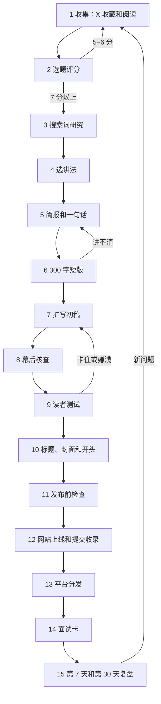

# 全流程总览

版本：2026-11-01。这一页把选题、写作、发布和复盘串成一条线。每一步的细则在对应文档里，这里只写顺序、谁负责、产出什么、什么时候算过关。

## 流程图

## 每一步

| 步骤 | 谁做 | 产出 | 过关标准 | 细则 |
| --- | --- | --- | --- | --- |
| 1 收集 | 作者收藏，Agent 整理 | `workbench/inbox/x-bookmarks.csv` 一行 | 有原始来源链接和收藏原因 | [sop.md](sop.md) 第 1 节 |
| 2 选题评分 | Agent 打分，作者拍板 | 简报里的评分表 | 10 分制达到 7 分 | [sop.md](sop.md) 第 2 节 |
| 3 搜索词研究 | Agent | 关键词表：主关键词、相关词、搜索意图、同名干扰 | 作者确认主关键词 | [seo-distribution.md](seo-distribution.md) |
| 4 选讲法 | Agent 出最多 4 个讲法，作者选 | 简报里的讲法菜单和选定结果 | 选定的讲法正文能兑现 | [title-cover-intro.md](title-cover-intro.md) |
| 5 简报和一句话 | Agent 写，作者确认 | `workbench/briefs/<slug>.md` | 读者、一句话、2–3 个读者问题都写清 | [研究简报模板](../templates/research-brief.md) |
| 6 300 字短版 | Agent | `distribution/<slug>/x-short.md` | 作者愿意转这条短帖 | [writing-agent.md](writing-agent.md) |
| 7 扩写初稿 | Agent 写，作者补经历和观点 | `workbench/drafts/<slug>.md` | 关键词落点齐全，用真实例子 | [style-reference.md](style-reference.md) |
| 8 幕后核查 | Agent 列表，作者删改 | `verification/<slug>.md` | 每条事实有出处 | [sop.md](sop.md) 第 5 节 |
| 9 读者测试 | 无上下文子 Agent | `verification/<slug>-reader-test.md` | 能复述、无卡点、主体不嫌浅 | [writing-agent.md](writing-agent.md) |
| 10 标题、封面和开头 | Agent 出候选，作者选 | 网站标题、平台标题、封面文字、开头 | 兑现检查全过 | [title-cover-intro.md](title-cover-intro.md) |
| 11 发布前检查 | Agent 跑脚本，作者过清单 | 核查文件末尾的检查结果 | lint 0 error，清单全勾 | [发布检查清单](../templates/publish-checklist.md) |
| 12 网站上线 | 作者合并 PR | 线上文章、sitemap、Search Console 请求 | 线上标题、描述、OG 图、目录正常 | [sop.md](sop.md) 第 6 节、[site-design.md](site-design.md) |
| 13 平台分发 | Agent 准备平台标题和 X 串推，作者手动发 | 同一正文发掘金、知乎、CSDN；X 串推；分发记录 | 正文和网站一致，文末一条“首发于”链接 | [platforms.md](platforms.md) |
| 14 面试卡 | Agent 起草，作者改 | `workbench/interview/<slug>.md` | 60 秒讲清，能答 5 个追问 | [面试案例卡模板](../templates/interview-card.md) |
| 15 复盘 | Agent 汇总数据，作者判断 | 复盘记录 | 只挑一个问题改 | [sop.md](sop.md) 第 9 节 |

## 几个关键顺序

- **先查搜索词，再定讲法，再写。** 搜索词决定网站标题和首段要出现什么词；讲法决定平台标题、封面和开头往哪个方向写。两件事都在动笔前做完。
- **网站标题服务搜索，平台标题服务推荐流。** 网站标题主关键词靠前；掘金、知乎、X 的标题可以用讲法菜单里面向更多人的说法，但不能超出正文。
- **标题、封面、开头的定稿放在读者测试之后。** 第 4 步只定方向；正文定稿后才知道能兑现什么，太早定稿容易写成正文给不了的承诺。
- **网站先上线，平台后发。** 网站是原始地址，平台发同一篇正文并链接回网站。
- **推荐号和周刊不跟单篇走。** 有可运行的项目、写完一个系列或做完整套资料时才投，规则见 [seo-distribution.md](seo-distribution.md)“推荐号和周刊”。
- **对外发布每次都由作者手动操作。** Agent 只准备内容和检查结果。

## 一篇文章的时间

| 阶段 | 步骤 | 预计 |
| --- | --- | --- |
| 选题 | 1–5 | 1 小时 |
| 写作 | 6–9 | 半天到 1 天 |
| 包装和检查 | 10–11 | 1 小时 |
| 发布和分发 | 12–13 | 1 小时，平台可分两天发 |
| 复用和复盘 | 14–15 | 发布后 24 小时内写面试卡，第 7、30 天各 15 分钟 |

这是第一篇正式发布前的估计，跑完两篇后按实际时间修改。
