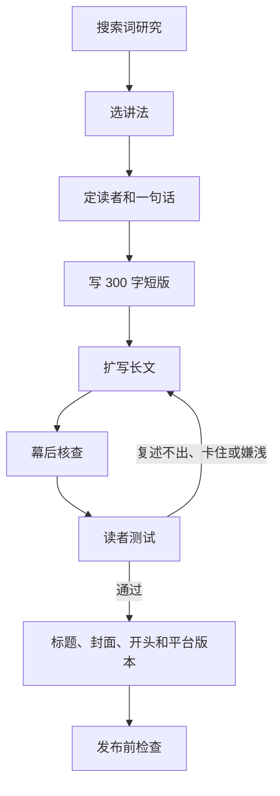

# 写作 Agent 流程

版本：2026-11-01（第三版）。执行入口：[tech-article-writer skill](../.agents/skills/tech-article-writer/SKILL.md)。全流程：[pipeline.md](pipeline.md)。写法样本：[style-reference.md](style-reference.md)。SEO 规则：[seo-distribution.md](seo-distribution.md)。

写作 Agent 负责搜索词研究、整理材料、写稿、核查，以及准备平台标题和 X 串推。观点、经历和最终事实由作者负责。默认读者是用过 Claude Code、Cursor、Copilot 等 AI 编程工具、没读过 Agent 框架源码的开发者和技术爱好者，文章要让其中至少 80% 的人读得懂，又不觉得被讲浅了。

## 流程

| 步骤 | 产出 | 作者要做的 |
| --- | --- | --- |
| 1. 搜索词研究 | 简报里的关键词表：主关键词、相关词、搜索意图、同名干扰、取词日期；讲法菜单，最多 4 个 | 确认主关键词，选一个讲法 |
| 2. 定读者和一句话 | 读者、读完能复述的一句话、读者关心的 2–3 个问题（优先取自搜索意图） | 确认这句话是自己的判断 |
| 3. 写 300 字短版 | X 短帖，同时检验题目大小 | 判断这条短帖自己愿不愿意转 |
| 4. 扩写长文 | 按 [style-reference.md](style-reference.md) 写的正文：关键词落点、真实例子、项目概念中英对照 | 补自己的经历和看法 |
| 5. 幕后核查 | 私有核查表，每条事实附出处 | 删掉或改写核实不了的说法 |
| 6. 读者测试 | 无上下文子 Agent 的复述、答题、卡点、嫌浅段落和它会用的搜索词 | 看卡点是否改到位 |
| 7. 标题、封面、开头和平台版本 | 3 个网站标题、1 段描述、各平台标题、1 套封面文字、开头检查、兑现检查；X 串推。掘金、知乎、CSDN 用网站同一正文 | 选标题和封面，发布前读一遍 |
| 8. 发布前检查 | 关键词落点、Fenng lint、AutoCorrect、lint-md 结果；AI 腔清单 | 无 |

## 为什么改

第一版流程把“事实核查”放在写作中心，dbs-plain-writing 写初稿，再逐条核对。结果是事实都对，但正文写成了给核查人看的东西：DeepSeek 那篇用了 10 多个英文名词，几乎每段都有“不能写成”“没有测过”这类限定，没写过 Agent 的读者看不下去。

第二版先定读者、先写短版、核查放幕后、读者测试作为门槛，这四处保留。但它把读者降到“没写过代码的人”，规定一篇最多 3 个新名词、用维修店这类生活类比贯穿全文。结果是技术内容被类比替换掉，开发者读着嫌浅，而且正文里搜不到“SuperAgent 架构”这类词。

第三版的调整：

- **SEO 放在第一步**。先查大家怎么搜，再决定标题、首段和小标题。文章写完再补关键词，往往只能塞进标签。
- **读者回到开发者**。Issue、PR、CI 这类词直接用；只解释项目自造的概念，写成“中文名（英文原名）”加一句说明。
- **用真实例子，不用无关类比**。直接讲源码里的规则、真实的 GitHub 场景和数字。确实需要对比时，用同领域的东西。
- **读者测试加一项“嫌浅”**。读者觉得某段在讲常识、想跳过，也算不通过。

写法规则来自 X 上传播较好的中文技术帖，样本和手法见 [style-reference.md](style-reference.md)。

## 参考过的 skill 和规范

| 来源 | 怎么用 |
| --- | --- |
| [Fenng/tech-doc-style-chinese](https://github.com/Fenng/tech-doc-style-chinese) | 黑话替换、同一概念用同一个词；脚本用于发布前检查 |
| dbs-plain-writing | 指代、术语、承诺强度的检查规则，不再用它写初稿 |
| dbs-ai-check | 发布前过一遍 AI 写作特征清单 |
| dbs-content-risk-check | 涉及公司、他人或敏感话题时查平台风险 |
| dbs-title-cover-intro | 讲法菜单、标题分工、封面文字和开头规则，改写成 [title-cover-intro.md](title-cover-intro.md)；方法源自“dontbesilent 内容方法论” |
| x-native-writer | X 长版和串推 |
| [中文技术文档的写作规范](https://github.com/ruanyf/document-style-guide)、[中文文案排版指北](https://github.com/sparanoid/chinese-copywriting-guidelines) | 排版参考，机器检查交给 AutoCorrect 和 lint-md |

dbs 系列面向自媒体内容诊断和说明文，和“讲清一个技术机制”的目标不完全一样，所以只取检查规则。

## 本地路径

| skill | 路径 |
| --- | --- |
| dbs-ai-check、dbs-content-risk-check、dbs-plain-writing、dbs-title-cover-intro | `~/.gemini/dbskill/skills/<name>/SKILL.md`（dbskill v3.1.0） |
| dbs-content-system | 同上，用于整理 X 收藏选题，见 [sop.md](sop.md) 第 1 节 |
| x-native-writer | `~/.codex/skills/x-native-writer/SKILL.md` |
| Fenng lint | `/tmp/fenng-style/scripts/lint_copy_rules.py`，没有时先 clone |

这些 skill 不进公开仓库。换电脑时先装好，再用本流程。

## 试跑记录

- 2026-11-01 第一版流程用 memory-agent 试跑，记录在 [trial-runs/2026-11-01-memory-agent/](trial-runs/2026-11-01-memory-agent/README.md)。
- 2026-11-01 第二版流程用 DeepSeek SuperAgent 那篇重写，新旧稿和对比放在私有工作区。
- 2026-11-01 第三版流程再写一版 DeepSeek SuperAgent，三版对比放在私有工作区。

公开文章不添加“本文由 AI 辅助研究与撰写”等制作声明、核查过程或检查通过报告；这些记录留在私有工作区。来源链接、影响结论的局限和示例性质照常保留。
